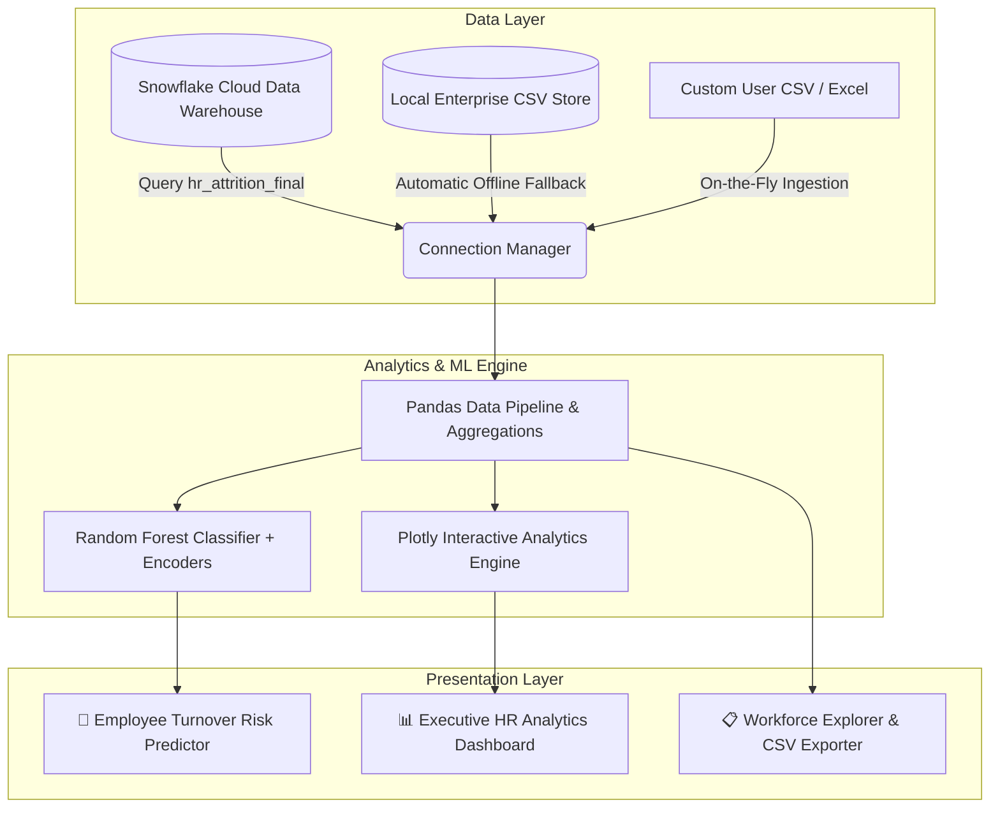

# 🏢 HR Attrition Analytics & Predictive Intelligence Dashboard

An enterprise-grade **Human Resources Attrition Diagnostic and Machine Learning Intelligence Platform** built with **Streamlit**, **Scikit-Learn**, **Plotly**, and **Snowflake**. 

The application helps organizations identify turnover drivers, monitor departmental retention health, explore talent trends, and predict employee turnover risk in real time to power proactive retention interventions.

<p align="center">
  <a href="https://cwhknp4dsxec6iprmqtx5e.streamlit.app/">
    
  </a>
  <a href="https://github.com/Siddhesh030/-HR-Attrition-Analytics-Dashboard">
    
  </a>
  
  
  
</p>

---

## 🌐 Live Application

Explore the live cloud deployment here:
🔗 **Live Interactive App:** [https://cwhknp4dsxec6iprmqtx5e.streamlit.app/](https://cwhknp4dsxec6iprmqtx5e.streamlit.app/)

*(Automatically synchronizes with live Snowflake warehouses when credentials are configured, or operates seamlessly on the bundled enterprise data store).*

---

## 📌 Executive Summary & Architecture

Employee attrition imposes high recruiting, onboarding, and productivity costs on enterprises. This dashboard bridges raw enterprise HR records with predictive machine learning to enable people leaders and HR business partners to:
1. **Diagnose Macro Trends:** Track overall attrition rate, compensation parity, overtime fatigue, and tenure demographics across departments.
2. **Forecast Individual Risk:** Estimate the turnover probability of individual employees using a trained **Random Forest Classifier** balanced with **SMOTE** (Synthetic Minority Over-sampling Technique).
3. **Prescribe Retention Interventions:** Provide targeted, actionable recommendations based on identified risk factors (e.g., commute relief, compensation review, workload rebalancing).



---

## ✨ Key Features

- **Resilient Dual-Source Data Ingestion:**
  - Connects directly to **Snowflake Data Warehouse** (`hr_attrition_final` table).
  - Automatically falls back to the embedded **Enterprise Data Store** (`data/hr_attrition_data.csv`) if warehouse credentials are not present or offline.
  - Allows uploading custom `.csv` or `.xlsx` files directly in the sidebar to analyze any organization's workforce records.
- **Dynamic Cross-Filtering:**
  - Multi-select by Department (`Engineering`, `Finance`, `HR`, `Marketing`, `Sales`).
  - Tenure Range slider (Years at Company).
  - OverTime status toggle (`All`, `Yes`, `No`).
  - Job Satisfaction score selector (1 to 4).
- **Executive Metric Cards:**
  - Real-time KPIs for Total Headcount, Attrition Headcount, Turnover Rate (%), Average Monthly Compensation (₹), and Average Tenure.
- **Interactive Visualizations (Plotly):**
  - Departmental Attrition Distribution (grouped bars).
  - Workforce Turnover Split (donut chart).
  - OverTime Impact vs Turnover.
  - Age Demographics Histogram with marginal box plot.
  - Monthly Compensation Violin & Box plots.
  - Job Satisfaction vs Attrition correlations.
  - Feature Importance Rankings from the trained model.
- **Individual Employee Risk Predictor:**
  - Real-time risk probability calculation.
  - Pre-configured persona buttons (*High-Risk Profile*, *Low-Risk Veteran*, *Sales Professional*, *HR Executive*).
  - Risk categorization (Low / Moderate / High Risk).
  - Tailored, actionable HR retention recommendations based on employee parameters.
- **Workforce Explorer & Export:**
  - Full-text search across employee records.
  - One-click CSV export of filtered data.

---

## 🛠️ Technology Stack

| Layer | Technologies |
|---|---|
| **Frontend & UI** | Streamlit, HTML5, Custom CSS |
| **Data Visualizations** | Plotly Express, Matplotlib, Seaborn |
| **Machine Learning** | Scikit-Learn (`RandomForestClassifier`), Imbalanced-Learn (`SMOTE`) |
| **Data Processing** | Pandas, NumPy, OpenPyXL |
| **Data Warehouse** | Snowflake (`snowflake-connector-python`) |
| **Deployment** | Streamlit Community Cloud / Render |

---

## 📋 Data Dictionary & Feature Schema

The machine learning model evaluates the following core workforce indicators:

| Feature | Type | Description |
|---|---|---|
| `AGE` | Integer | Age of employee in years (18 - 65) |
| `DEPARTMENT` | Categorical | Business unit (`engineering`, `finance`, `hr`, `marketing`, `sales`) |
| `JOB_ROLE` | Categorical | Specific functional title (e.g., Software Engineer, Tech Lead, Sales Exec) |
| `GENDER` | Categorical | Gender (`Male`, `Female`) |
| `MARITAL_STATUS` | Categorical | Marital status (`Divorced`, `Married`, `Single`, `Unknown`) |
| `PERFORMANCE_RATING` | Integer | Annual performance appraisal tier (1 - 4) |
| `OVERTIME` | Categorical | Whether the employee frequently logs overtime (`Yes`, `No`) |
| `DISTANCE_FROM_HOME` | Integer | Commute distance in kilometers (1 - 60) |
| `MONTHLY_INCOME` | Float | Base monthly compensation in ₹ |
| `YEARS_AT_COMPANY` | Integer | Organizational tenure in years |
| `JOB_SATISFACTION` | Integer | Self-reported satisfaction score (1: Low - 4: High) |
| `ATTRITION` | Target | Employment status (`Yes` = Left company, `No` = Retained) |

---

## ⚙️ Local Setup and Installation

### 1. Clone Repository
```bash
git clone https://github.com/Siddhesh030/-HR-Attrition-Analytics-Dashboard.git
cd -HR-Attrition-Analytics-Dashboard
```

### 2. Create Virtual Environment
```bash
# Windows
python -m venv venv
venv\Scripts\activate

# macOS / Linux
python3 -m venv venv
source venv/bin/activate
```

### 3. Install Dependencies
```bash
pip install -r requirements.txt
```

### 4. Configure Snowflake Credentials (Optional)
Create a `.env` file in the root directory (or use `.streamlit/secrets.toml`):
```ini
SNOWFLAKE_USER=your_username
SNOWFLAKE_PASSWORD=your_password
SNOWFLAKE_ACCOUNT=your_account_identifier
SNOWFLAKE_WAREHOUSE=your_warehouse
SNOWFLAKE_DATABASE=your_database
SNOWFLAKE_SCHEMA=your_schema
```
*(Note: If Snowflake credentials are not supplied, the app automatically runs in offline enterprise cache mode using `data/hr_attrition_data.csv`).*

### 5. Launch the Dashboard
```bash
streamlit run app.py
```
Open your browser at `http://localhost:8501`.

---

## ☁️ Deployment Configurations

### Streamlit Community Cloud
1. Link your GitHub repository: `Siddhesh030/-HR-Attrition-Analytics-Dashboard`.
2. Set Main file path: `app.py`.
3. (Optional) In **App Settings > Secrets**, paste your Snowflake credentials:
   ```toml
   SNOWFLAKE_USER = "your_user"
   SNOWFLAKE_PASSWORD = "your_password"
   SNOWFLAKE_ACCOUNT = "your_account"
   SNOWFLAKE_WAREHOUSE = "your_warehouse"
   SNOWFLAKE_DATABASE = "your_database"
   SNOWFLAKE_SCHEMA = "your_schema"
   ```

---

## 📄 License
This project is open-source and available under the [MIT License](LICENSE).
